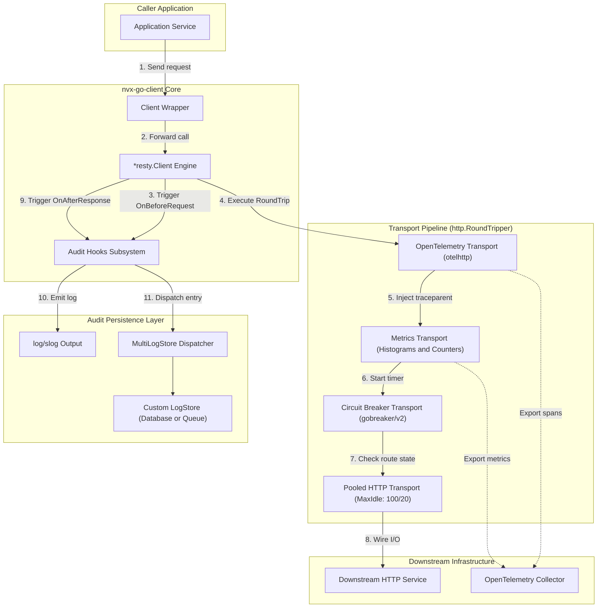
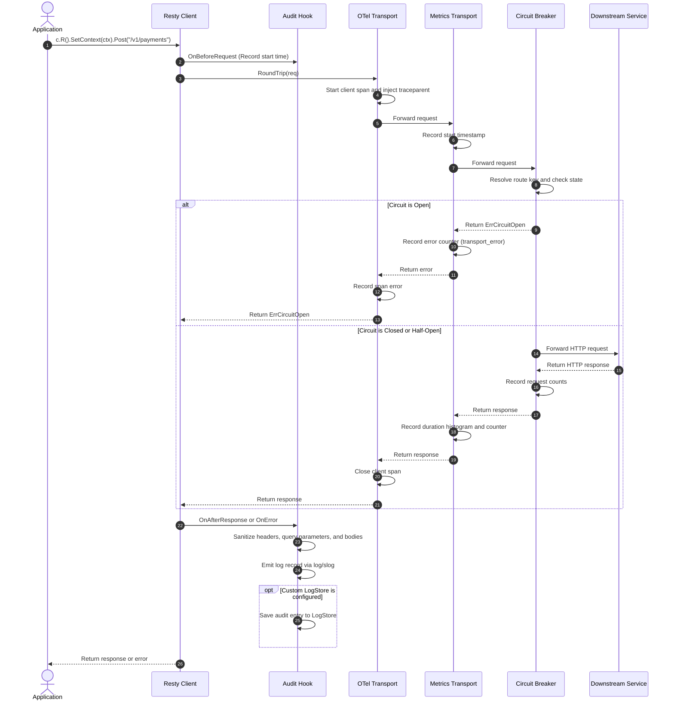
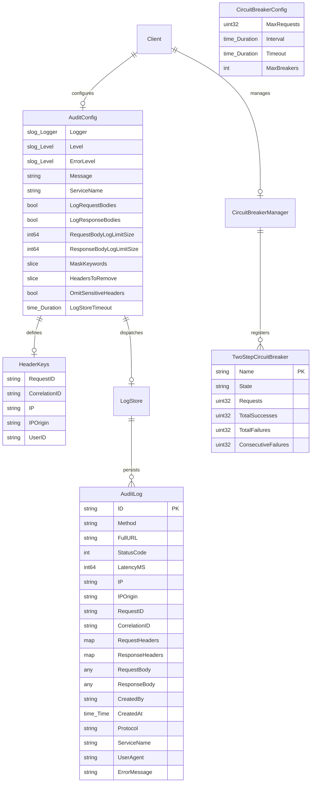
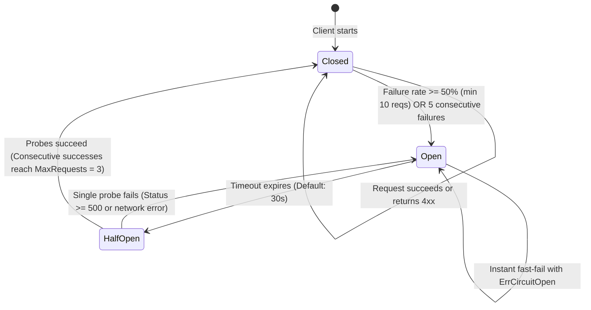

# nvx-go-client

[](https://go.dev/)
[](LICENSE)
[]()

The `nvx-go-client` module provides an instrumented HTTP client for Go applications. The client builds on top of [go-resty/resty](https://github.com/go-resty/resty).

The library injects W3C distributed trace context into outbound HTTP requests automatically. The transport pipeline records latency histograms and request counters via OpenTelemetry.

A dynamic circuit breaker prevents cascading system outages across microservices. The client normalizes dynamic route paths to stop memory growth.

The audit logging engine records structured request and response records via `log/slog`. The engine masks sensitive credentials and query parameters in headers, URLs, and bodies. Pluggable storage handlers write audit records to multiple outputs.

---

## Table of Contents

- [1. Features](#1-features)
- [2. Installation](#2-installation)
- [3. Quick Start](#3-quick-start)
- [4. Advanced Usage](#4-advanced-usage)
  - [4.1 Dynamic Route-Based Circuit Breaker](#41-dynamic-route-based-circuit-breaker)
  - [4.2 Explicit Route Pattern Override](#42-explicit-route-pattern-override)
  - [4.3 Outbound Audit Logging](#43-outbound-audit-logging)
  - [4.4 Custom Audit Storage and Multi-Target Dispatching](#44-custom-audit-storage-and-multi-target-dispatching)
  - [4.5 Connection Pool and Graceful Shutdown](#45-connection-pool-and-graceful-shutdown)
  - [4.6 Custom OpenTelemetry Options](#46-custom-opentelemetry-options)
  - [4.7 Advanced Resty Configuration](#47-advanced-resty-configuration)
  - [4.8 Custom Transport and mTLS](#48-custom-transport-and-mtls)
- [5. Available Options Reference](#5-available-options-reference)
  - [5.1 Client Options](#51-client-options)
  - [5.2 Circuit Breaker Options](#52-circuit-breaker-options)
  - [5.3 Audit Options](#53-audit-options)
- [6. System Architecture and Under the Hood](#6-system-architecture-and-under-the-hood)
  - [6.1 High-Level Architecture](#61-high-level-architecture)
  - [6.2 Outbound Request Lifecycle](#62-outbound-request-lifecycle)
  - [6.3 Data Schema Model](#63-data-schema-model)
  - [6.4 Dynamic Route Normalization and Cardinality Protection](#64-dynamic-route-normalization-and-cardinality-protection)
  - [6.5 Circuit Breaker State Transitions](#65-circuit-breaker-state-transitions)
  - [6.6 Connection Pooling Defaults](#66-connection-pooling-defaults)
  - [6.7 OpenTelemetry and Metric Transport Invariant](#67-opentelemetry-and-metric-transport-invariant)
- [7. Testing and Quality Gates](#7-testing-and-quality-gates)
- [8. Contributing](#8-contributing)
- [9. License](#9-license)

---

## 1. Features

- **Built on Resty Core:** Inherits automatic retries, timeouts, JSON unmarshaling, and request chaining from `resty.Client`.
- **Automatic OpenTelemetry Tracing:** Injects standard W3C `traceparent` headers into outgoing requests.
- **Client Latency and Request Metrics:** Measures duration histograms and total request counters using OpenTelemetry metrics.
- **Route-Aware Dynamic Circuit Breaker:** Uses `sony/gobreaker/v2` to isolate failing downstream endpoints by normalized route keys.
- **Dynamic Route Normalization:** Collapses numbers, UUIDs, MongoDB ObjectIDs, and ULIDs into `{param}` tokens to prevent memory growth.
- **Structured Audit Logging:** Emits structured outbound records through `log/slog` with sensitive credential masking.
- **Pluggable Audit Storage:** Writes audit entries to custom databases or message queues via the `LogStore` interface.
- **Sensitive URL Sanitization:** Redacts sensitive query parameters in logged URLs to prevent token leaks.
- **Tuned Connection Pooling:** Uses high-throughput connection pool defaults (`MaxIdleConns: 100`, `MaxIdleConnsPerHost: 20`, `IdleConnTimeout: 90s`).
- **Connection Resource Cleanup:** Provides `CloseIdleConnections()` to release pooled sockets during application shutdown.

---

## 2. Installation

Install the package using the Go module tool:

```bash
go get github.com/Jkenyut/nvx-go-client
```

---

## 3. Quick Start

Follow these procedural steps to initialize the client and send an HTTP request:

```go
package main

import (
	"context"
	"fmt"
	"log"
	"time"

	"github.com/Jkenyut/nvx-go-client"
)

func main() {
	// 1. Initialize the client with functional configuration options.
	c := client.New(
		client.WithBaseURL("https://jsonplaceholder.typicode.com"),
		client.WithTimeout(10 * time.Second),
		client.WithRetry(3, 100 * time.Millisecond),
	)
	defer c.CloseIdleConnections()

	// 2. Create a request context for trace propagation.
	ctx := context.Background()

	// 3. Execute the HTTP GET request.
	resp, err := c.R().
		SetContext(ctx).
		Get("/todos/1")

	if err != nil {
		log.Fatalf("Request failed: %v", err)
	}

	// 4. Inspect the HTTP status code.
	fmt.Printf("Status: %s\n", resp.Status())
	fmt.Printf("Body: %s\n", resp.String())
}
```

---

## 4. Advanced Usage

### 4.1 Dynamic Route-Based Circuit Breaker

Enable route-aware circuit breaking to protect your services from cascading outages:

```go
package main

import (
	"context"
	"errors"
	"time"

	"github.com/Jkenyut/nvx-go-client"
)

func main() {
	c := client.New(
		client.WithBaseURL("https://api.payment.internal"),
		client.WithCircuitBreaker(
			client.WithCBTimeout(30 * time.Second), // Sleep duration in Open state
			client.WithCBMaxRequests(3),            // Trial requests in Half-Open state
		),
	)
	defer c.CloseIdleConnections()

	ctx := context.Background()

	// The normalizer collapses dynamic parameters into: "GET api.payment.internal/orders/{param}"
	resp, err := c.R().
		SetContext(ctx).
		Get("/orders/12345?notify=true")

	if errors.Is(err, client.ErrCircuitOpen) {
		// The breaker rejected the request immediately without network I/O.
		return
	}
}
```

### 4.2 Explicit Route Pattern Override

Bind an explicit route pattern to the request context when URLs contain custom non-numeric slugs:

```go
ctx := client.WithRoutePattern(context.Background(), "/users/{username}")

resp, err := c.R().
	SetContext(ctx).
	Get("/users/johndoe")
```

### 4.3 Outbound Audit Logging

Emit structured outbound audit logs through Go standard library `log/slog`. The logging engine sanitizes headers, query parameters, and JSON bodies.

#### Using Functional Options (`WithAuditConfig`):
```go
c := client.New(
	client.WithBaseURL("https://api.partner.com"),
	client.WithAuditConfig(
		client.WithAuditLogger(slog.Default()),
		client.WithAuditServiceName("checkout-service"),
		client.WithAuditBodyLogging(true, true),
		client.WithAuditBodyLimits(3*1024*1024, 5*1024*1024), // 3MB req, 5MB resp
		client.WithAuditMaskKeywords("custom_token", "tax_number"),
		client.WithAuditOmitSensitiveHeaders(true),
	),
)
```

#### Using Configuration Struct (`WithAudit`):
```go
package main

import (
	"context"
	"log/slog"
	"os"

	"github.com/Jkenyut/nvx-go-client"
)

func main() {
	logger := slog.New(slog.NewJSONHandler(os.Stdout, nil))

	c := client.New(
		client.WithBaseURL("https://api.partner.com"),
		client.WithAudit(client.AuditConfig{
			Logger:                   logger,
			ServiceName:              "checkout-service",
			LogRequestBodies:         true,
			LogResponseBodies:        true,
			RequestBodyLogLimitSize:  3 * 1024 * 1024,
			ResponseBodyLogLimitSize: 5 * 1024 * 1024,
			MaskKeywords:             []string{"custom_token", "tax_number"},
		}),
	)
	defer c.CloseIdleConnections()

	ctx := context.Background()
	_, _ = c.R().SetContext(ctx).SetBody(payload).Post("/v1/charge")
}
```

### 4.4 Custom Audit Storage and Multi-Target Dispatching

Implement the `LogStore` interface (`Save(ctx context.Context, entry *client.AuditLog) error`) to persist audit logs to databases or message queues. Use `MultiLogStore` to dispatch to multiple destinations:

```go
// 1. Combine console logging with an external database store.
customStore := &DatabaseStore{db: myDB} // Implements client.LogStore
compositeStore := client.MultiLogStore(
	client.NewConsoleStore(slog.Default()), // Standard output logger
	customStore,                            // Database or message broker store
)

// 2. Configure the client with the composite store.
c := client.New(
	client.WithBaseURL("https://api.partner.com"),
	client.WithLogStore(compositeStore),
	client.WithAuditConfig(
		client.WithAuditServiceName("order-service"),
		client.WithAuditLogStoreTimeout(3 * time.Second),
	),
)
```

### 4.5 Connection Pool and Graceful Shutdown

Release pooled TCP sockets during application shutdown:

```go
c := client.New(
	client.WithBaseURL("https://api.internal.service"),
	client.WithTimeout(10 * time.Second),
)

// Call CloseIdleConnections during service termination.
defer c.CloseIdleConnections()
```

### 4.6 Custom OpenTelemetry Options

Pass custom `otelhttp.Option` values via `WithOTelOptions`:

```go
import (
	"net/http"

	"github.com/Jkenyut/nvx-go-client"
	"go.opentelemetry.io/contrib/instrumentation/net/http/otelhttp"
)

c := client.New(
	client.WithBaseURL("https://api.internal.service"),
	client.WithOTelOptions(
		otelhttp.WithSpanNameFormatter(func(operation string, r *http.Request) string {
			return "HTTP " + r.Method + " " + r.URL.Path
		}),
	),
)
```

### 4.7 Advanced Resty Configuration

Configure the underlying `resty.Client` directly with `WithResty`:

```go
c := client.New(
	client.WithBaseURL("https://api.internal.service"),
	client.WithResty(func(r *resty.Client) {
		r.SetAuthToken("my-secret-token").
			SetHeader("Accept", "application/json").
			SetHeader("X-Client-Version", "1.0.0")
	}),
)
```

### 4.8 Custom Transport and mTLS

Pass a custom `http.RoundTripper` to configure Mutual TLS (mTLS) or proxies:

```go
tlsConfig := &tls.Config{
	MinVersion: tls.VersionTLS13,
}

customTransport := &http.Transport{
	TLSClientConfig: tlsConfig,
}

c := client.New(
	client.WithTransport(customTransport),
)
```

---

## 5. Available Options Reference

### 5.1 Client Options

| Option | Default | Description (ASD-STE100) |
| :--- | :--- | :--- |
| `client.WithTimeout(d)` | `30s` | Sets request timeout duration. |
| `client.WithTimeoutMS(ms)` | `30000ms` | Sets request timeout in milliseconds. |
| `client.WithBaseURL(url)` | `""` | Sets target base URL for requests. |
| `client.WithRetry(count, wait)` | `0`, `0s` | Sets retry count and wait duration. |
| `client.WithRetryMS(count, waitMS)` | `0`, `0ms` | Sets retry count and wait time in milliseconds. |
| `client.WithCircuitBreaker(opts...)` | Disabled | Enables dynamic route-aware circuit breaking. |
| `client.WithAudit(cfg)` | Disabled | Enables audit logging using configuration struct. |
| `client.WithAuditConfig(opts...)` | Disabled | Enables audit logging using functional options. |
| `client.WithLogStore(store)` | Disabled | Sets custom audit storage destination. |
| `client.WithTransport(rt)` | Cloned `http.DefaultTransport` | Sets custom base network transport. |
| `client.WithOTelOptions(opts...)` | None | Passes OpenTelemetry transport configuration options. |
| `client.WithResty(fn)` | `nil` | Configures underlying Resty client instance. |

### 5.2 Circuit Breaker Options

| Option | Default | Description (ASD-STE100) |
| :--- | :--- | :--- |
| `client.WithCBTimeout(d)` | `30s` | Sets cooldown duration in open state. |
| `client.WithCBTimeoutMS(ms)` | `30000ms` | Sets open state duration in milliseconds. |
| `client.WithCBInterval(d)` | `30s` | Sets cyclic duration to clear closed state counts. |
| `client.WithCBIntervalMS(ms)` | `30000ms` | Sets cyclic count duration in milliseconds. |
| `client.WithCBMaxRequests(n)` | `3` | Sets allowed probe requests in half-open state. |
| `client.WithCBMaxBreakers(n)` | `1000` | Sets maximum circuit breakers kept in memory. |
| `client.WithCBReadyToTrip(fn)` | Standard Gate | Sets trip predicate function for open state. |
| `client.WithCBIsFailure(fn)` | `5xx` / Network Errors | Sets error classification predicate function. |
| `client.WithCBOnStateChange(fn)` | `nil` | Sets notification callback for state transitions. |
| `client.WithCBRouteKeyFunc(fn)` | `DefaultRouteKey` | Sets route key generation function. |
| `client.WithRoutePattern(ctx, pat)` | None | Binds explicit route pattern to context. |

### 5.3 Audit Options

| Option | Default | Description (ASD-STE100) |
| :--- | :--- | :--- |
| `client.WithAuditLogger(logger)` | `slog.Default()` | Sets logger used for audit records. |
| `client.WithAuditLevels(info, err)` | `LevelInfo`, `LevelError` | Sets log levels for success and failure records. |
| `client.WithAuditMessage(msg)` | `"outbound HTTP request"` | Sets message string for audit entries. |
| `client.WithAuditServiceName(name)` | `""` | Sets service name attribute in audit records. |
| `client.WithAuditBodyLogging(req, resp)` | `false`, `false` | Enables request and response body logging. |
| `client.WithAuditBodyLimits(req, resp)` | `3MB`, `5MB` | Sets byte size thresholds for logged bodies. |
| `client.WithAuditMaskKeywords(kw...)` | Default Keywords | Appends keywords for sensitive data masking. |
| `client.WithAuditHeaders(keys)` | `DefaultHeaderKeys()` | Sets header keys for metadata extraction. |
| `client.WithAuditHeadersToRemove(hdrs...)` | None | Sets headers dropped completely from logs. |
| `client.WithAuditOmitSensitiveHeaders(b)` | `false` | Drops sensitive headers instead of masking values. |
| `client.WithAuditContextAttrs(fn)` | Activity Fallback | Sets custom context attribute extraction function. |
| `client.WithAuditIDGenerator(fn)` | UUID v7 | Sets unique identifier generator function. |
| `client.WithAuditLogStore(store)` | None | Sets custom `LogStore` destination. |
| `client.WithAuditStore(store)` | None | Acts as alias for `WithAuditLogStore`. |
| `client.WithAuditLogStoreTimeout(d)` | `5s` | Sets execution timeout for storage saves. |

---

## 6. System Architecture and Under the Hood

### 6.1 High-Level Architecture

The diagram shows the component architecture and outbound request pipeline:



### 6.2 Outbound Request Lifecycle

The sequence diagram illustrates the lifecycle of an outbound HTTP call:



### 6.3 Data Schema Model

The entity-relationship diagram shows the core configuration and log structures:



### 6.4 Dynamic Route Normalization and Cardinality Protection

The circuit breaker groups requests by canonical route key (`METHOD Host/normalized_path`):

1. **Query String Stripping:** Strips query strings before route key calculation (`/api/v1/users?sort=desc` becomes `/api/v1/users`).
2. **Dynamic Identifier Detection:** Collapses dynamic path parameters into `{param}`:
   - **Numeric Identifiers:** `/users/12345/orders/6789` becomes `/users/{param}/orders/{param}`.
   - **UUID Strings:** `/items/550e8400-e29b-41d4-a716-446655440000` becomes `/items/{param}`.
   - **MongoDB ObjectIDs:** `/docs/507f1f77bcf86cd799439011` becomes `/docs/{param}`.
   - **ULID and KSUID Values:** `/events/01ARZ3NDEKTSV4RRFFQ69G5FAV` becomes `/events/{param}`.
3. **Bounded Memory Registry:** Limits registered circuit breakers (`MaxBreakers: 1000`). The manager prunes healthy closed breakers first to protect open breaker states.

### 6.5 Circuit Breaker State Transitions

The state diagram defines transitions across closed, open, and half-open states:



- **Trip Gate:** Requires at least 10 requests within a 30-second window before evaluating failure rates.
- **Fail-Fast:** Transitions to `Open` when the failure rate reaches 50% or 5 consecutive failures occur.
- **Success Criteria:** Treats `4xx` responses as successes from the breaker perspective because the upstream service answered.
- **Exclusions:** Excludes `context.Canceled` errors from failure counts.

### 6.6 Connection Pooling Defaults

Go's `http.DefaultTransport` limits idle connections per host to 2. The `nvx-go-client` library provisions an isolated transport with tuned production defaults:

- **`MaxIdleConns: 100`:** Keeps up to 100 total idle connections open across all hosts.
- **`MaxIdleConnsPerHost: 20`:** Keeps up to 20 idle connections open per individual host.
- **`IdleConnTimeout: 90s`:** Closes idle connections after 90 seconds of inactivity.
- **`TLSHandshakeTimeout: 10s`:** Sets timeout for TLS connection establishment.
- **`ExpectContinueTimeout: 1s`:** Sets timeout for HTTP 100-continue header response.

### 6.7 OpenTelemetry and Metric Transport Invariant

Calling `c.SetTransport()` preserves OpenTelemetry tracing, metrics collection, and circuit breaking:

```go
func (c *Client) SetTransport(transport http.RoundTripper) *Client {
	if transport == nil {
		transport = defaultTransport()
	}

	current := transport
	if c.cbManager != nil {
		current = newCircuitBreakerTransport(current, c.cbManager)
	}

	var otelTransport http.RoundTripper
	if ot, ok := current.(*otelhttp.Transport); ok {
		otelTransport = ot
	} else {
		metricsWrapped := newMetricsTransport(current)
		otelTransport = otelhttp.NewTransport(metricsWrapped, c.otelOpts...)
	}

	c.Client.SetTransport(otelTransport)
	return c
}
```

The outer OpenTelemetry transport creates trace spans for all outgoing requests. The middle metrics transport records latency and error metrics. The inner circuit breaker evaluates route health before sending network traffic.

---

## 7. Testing and Quality Gates

Execute unit tests, race detector verification, and static analysis:

```bash
# Run unit test suite with race detector and code coverage
go test -v -race -cover ./...

# Run benchmarks
go test -run=^$ -bench=. -benchmem ./...

# Run static code analysis
go vet ./...
```

### Benchmark Results (Apple M4)

| Benchmark | Latency | Memory | Heap Allocations | Operational Notes |
| :--- | :--- | :--- | :--- | :--- |
| `BenchmarkNormalizePath` | **140 ns/op** | 96 B/op | **1 alloc/op** | Single allocation byte scanner |
| `BenchmarkCircuitBreaker_AllowedRequest` | **33.8 µs/op** | 13.3 KB/op | 124 allocs/op | Roundtrip with OpenTelemetry and circuit breaker |
| `BenchmarkClient_Request` | **31.9 µs/op** | 13.2 KB/op | 121 allocs/op | Baseline roundtrip with OpenTelemetry |
| **Circuit Breaker Net Overhead** | **+1.9 µs/op** | **+180 B/op** | **+3 allocs/op** | Negligible impact on real network throughput |

---

## 8. Contributing

Contributions are welcome. Please read our [CONTRIBUTING.md](CONTRIBUTING.md) for branch organization and commit conventions.

---

## 9. License

Distributed under the [Apache 2.0 License](LICENSE).