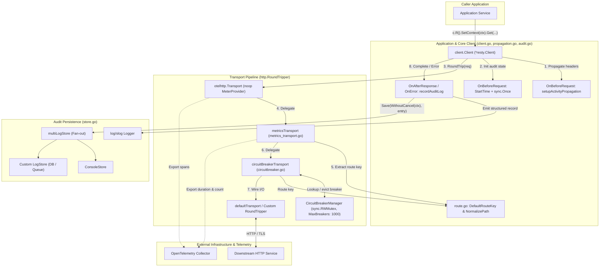
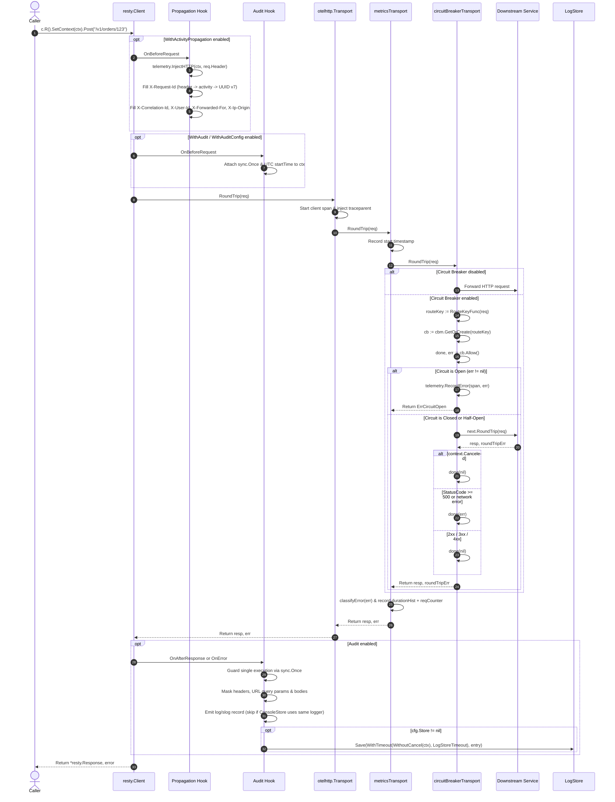
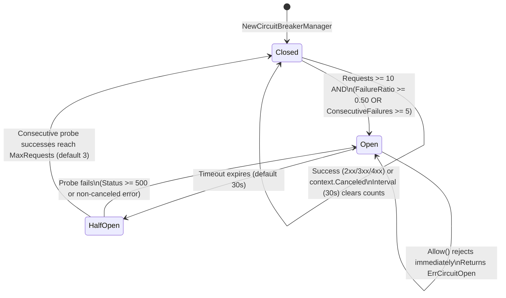
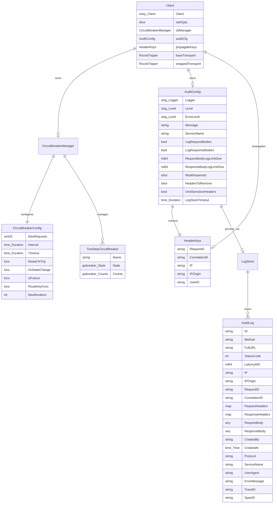

# nvx-go-client

[](go.mod)
[](LICENSE)
[]()

The `nvx-go-client` module (`github.com/Jkenyut/nvx-go-client`, package `client`) provides an instrumented outbound HTTP client for Go applications built on [go-resty/resty](https://github.com/go-resty/resty).

The library wraps the underlying `http.RoundTripper` pipeline with OpenTelemetry tracing (`otelhttp`), OpenTelemetry duration/request metrics (`nvx-go-telemetry`), and a route-aware dynamic circuit breaker (`sony/gobreaker/v2`). It also provides Resty hooks for W3C/activity header propagation and structured `log/slog` audit logging with sensitive data masking and pluggable `LogStore` persistence.

> [!NOTE]
> `nvx-go-client` is an outbound Go client library. It contains no inbound HTTP routes/handlers, no SQL database migrations (`migrations/`), and no YAML/environment configuration loader. All architecture diagrams, data models, and reference catalogs below reflect the exact Go types, transport layers, options, and `Makefile` targets present in this repository.

---

## Table of Contents

- [1. Features](#1-features)
- [2. Installation](#2-installation)
- [3. Quick Start](#3-quick-start)
- [4. Visual Architecture](#4-visual-architecture)
  - [4.1 System Architecture](#41-system-architecture)
  - [4.2 Core Workflow: Outbound Request, Propagation, Metrics & Audit](#42-core-workflow-outbound-request-propagation-metrics--audit)
  - [4.3 Circuit Breaker State Machine](#43-circuit-breaker-state-machine)
  - [4.4 Domain & Configuration Data Model](#44-domain--configuration-data-model)
- [5. Engineering & Storage Trade-Offs](#5-engineering--storage-trade-offs)
  - [5.1 Transport Layering & Double-Wrapping Invariant](#51-transport-layering--double-wrapping-invariant)
  - [5.2 Bounded Circuit Breaker Registry & Two-Pass Eviction](#52-bounded-circuit-breaker-registry--two-pass-eviction)
  - [5.3 Zero-Regex Dynamic Route Normalization](#53-zero-regex-dynamic-route-normalization)
  - [5.4 Single-Audit Guarantee & Detached Store Context](#54-single-audit-guarantee--detached-store-context)
  - [5.5 Concurrent Multi-Target Audit Dispatch](#55-concurrent-multi-target-audit-dispatch)
  - [5.6 Tuned Connection Pool Defaults](#56-tuned-connection-pool-defaults)
- [6. Source-Verified Reference Catalogs](#6-source-verified-reference-catalogs)
  - [6.1 Business Metric & Telemetry Catalog](#61-business-metric--telemetry-catalog)
  - [6.2 HTTP Header & Propagation Contract](#62-http-header--propagation-contract)
  - [6.3 Configuration & Options Matrix](#63-configuration--options-matrix)
  - [6.4 Public Go API Catalog](#64-public-go-api-catalog)
- [7. Operational Runbook & Makefile Targets](#7-operational-runbook--makefile-targets)
- [8. Annotated Repository Directory Tree](#8-annotated-repository-directory-tree)
- [9. Contributing & License](#9-contributing--license)

---

## 1. Features

- **Resty Core Integration:** Inherits retries, timeouts, request builders, and response parsing from `*resty.Client`.
- **OpenTelemetry Tracing:** Wraps the transport with `otelhttp.NewTransport` (with `noop.NewMeterProvider()` so `metricsTransport` owns metric emission without duplication).
- **Latency & Request Metrics:** Records `http.client.request.duration` histograms and `http.client.requests.total` counters via `nvx-go-telemetry`.
- **Activity & W3C Propagation:** Injects W3C `traceparent`/`baggage` and propagates `X-Request-Id`, `X-Correlation-Id`, `X-User-Id`, `X-Forwarded-For`, and `X-Ip-Origin` via `WithActivityPropagation`.
- **Route-Aware Circuit Breaker:** Isolates failing downstream routes using `gobreaker.TwoStepCircuitBreaker[struct{}]` keyed by normalized `METHOD host/normalized_path`.
- **Dynamic Path Normalization:** Collapses numeric IDs, UUIDs, MongoDB ObjectIDs, hex hashes, ULIDs, and KSUIDs into `{param}` to bound memory and metric cardinality.
- **Structured Audit Logging:** Emits `log/slog` records with sensitive header masking/omission, query parameter redaction, and JSON/text body masking.
- **Pluggable Audit Persistence:** Persists `AuditLog` entries to one or more `LogStore` backends concurrently via `MultiLogStore`.
- **Tuned Connection Pooling:** Provisions `MaxIdleConns: 100`, `MaxIdleConnsPerHost: 20`, `MaxConnsPerHost: 100`, and `IdleConnTimeout: 90s`, with `CloseIdleConnections()` for graceful shutdown.

---

## 2. Installation

Install the module using the Go toolchain:

```bash
go get github.com/Jkenyut/nvx-go-client
```

---

## 3. Quick Start

Initialize `client.New(...)` with functional options and execute an outbound request:

```go
package main

import (
	"context"
	"errors"
	"log"
	"log/slog"
	"os"
	"time"

	client "github.com/Jkenyut/nvx-go-client"
)

func main() {
	logger := slog.New(slog.NewJSONHandler(os.Stdout, nil))

	c := client.New(
		client.WithBaseURL("https://api.example.internal"),
		client.WithTimeout(10*time.Second),
		client.WithRetry(2, 100*time.Millisecond),
		client.WithActivityPropagation(),
		client.WithCircuitBreaker(
			client.WithCBTimeout(30*time.Second),
			client.WithCBMaxRequests(3),
		),
		client.WithAuditConfig(
			client.WithAuditLogger(logger),
			client.WithAuditServiceName("order-service"),
			client.WithAuditBodyLogging(true, true),
		),
	)
	defer c.CloseIdleConnections()

	ctx := client.WithRoutePattern(context.Background(), "/v1/orders/{id}")
	resp, err := c.R().
		SetContext(ctx).
		Get("/v1/orders/12345")
	if err != nil {
		if errors.Is(err, client.ErrCircuitOpen) {
			log.Printf("circuit open: %v", err)
			return
		}
		log.Fatalf("request failed: %v", err)
	}

	log.Printf("status=%d", resp.StatusCode())
}
```

---

## 4. Visual Architecture

### 4.1 System Architecture

The following diagram maps every component in `nvx-go-client` across caller, core client, transport pipeline, persistence, and telemetry boundaries:



### 4.2 Core Workflow: Outbound Request, Propagation, Metrics & Audit

The sequence diagram traces an outbound HTTP request through propagation hooks, OpenTelemetry instrumentation, metric recording, circuit breaker gating, and audit sanitization/persistence:



### 4.3 Circuit Breaker State Machine

`circuitBreakerTransport` uses `gobreaker.TwoStepCircuitBreaker[struct{}]` with the following verified state transitions (`circuitbreaker.go`):



### 4.4 Domain & Configuration Data Model

Because `nvx-go-client` has no SQL database or `migrations/` directory, the diagram models the exact Go structs and interfaces defined in `client.go`, `circuitbreaker.go`, `audit.go`, and `store.go`:



---

## 5. Engineering & Storage Trade-Offs

### 5.1 Transport Layering & Double-Wrapping Invariant

`Client.SetTransport` (`client.go:L73-L120`) unwraps any existing `*metricsTransport` or `*circuitBreakerTransport` layers before re-applying the middleware chain (`otelhttp.Transport` -> `metricsTransport` -> `circuitBreakerTransport` -> `baseTransport`). It also passes `otelhttp.WithMeterProvider(noop.NewMeterProvider())` so `otelhttp` emits only trace spans while `metricsTransport` owns metric emission without duplicate counters or histograms.

```go
// client.go:L82-L115
	for {
		if mt, ok := transport.(*metricsTransport); ok {
			transport = mt.base
			continue
		}
		if cbt, ok := transport.(*circuitBreakerTransport); ok {
			transport = cbt.next
			continue
		}
		break
	}
// ...
	metricsWrapped := newMetricsTransport(current)
	otelOpts := make([]otelhttp.Option, 0, 1+len(c.otelOpts))
	otelOpts = append(otelOpts, otelhttp.WithMeterProvider(noop.NewMeterProvider()))
	otelOpts = append(otelOpts, c.otelOpts...)
	otelTransport := otelhttp.NewTransport(metricsWrapped, otelOpts...)
```

### 5.2 Bounded Circuit Breaker Registry & Two-Pass Eviction

`CircuitBreakerManager.GetOrCreate` (`circuitbreaker.go:L148-L218`) uses double-checked locking with `sync.RWMutex` and enforces `MaxBreakers` (default `1000`). When capacity is reached, Pass 1 evicts only `StateClosed` (healthy) breakers down to `75%` capacity (`MaxBreakers*3/4`), preserving open/half-open failure states. Pass 2 evicts arbitrary entries down to `75%` only if all breakers are open or half-open.

```go
// circuitbreaker.go:L185-L204
	if m.cfg.MaxBreakers > 0 && len(m.breakers) >= m.cfg.MaxBreakers {
		// Pass 1: Prune closed (healthy) breakers to preserve open/half-open tripping states
		for k, b := range m.breakers {
			if b.State() == gobreaker.StateClosed {
				delete(m.breakers, k)
				if len(m.breakers) <= m.cfg.MaxBreakers*3/4 {
					break
				}
			}
		}
		// Pass 2: If still at limit (all breakers open/half-open), prune oldest entries to admit new
		if len(m.breakers) >= m.cfg.MaxBreakers {
			for k := range m.breakers {
				delete(m.breakers, k)
				if len(m.breakers) <= m.cfg.MaxBreakers*3/4 {
					break
				}
			}
		}
	}
```

### 5.3 Zero-Regex Dynamic Route Normalization

`NormalizePath` (`route.go:L39-L79`) strips query strings/fragments and scans path segments in a single pass using `strings.Builder` pre-grown by `len(path) + 8` bytes. `isDynamicParam` (`route.go:L138-L165`) classifies templated segments (`{...}`, `:...`), numeric IDs, 36-char UUIDs (`cryptoutil.IsValid`), 24/32/40/64-char hex IDs/hashes, and 26/27-char ULID/KSUID tokens into `{param}` without regular expression compilation. Callers can bypass heuristics entirely via `WithRoutePattern(ctx, pattern)`.

### 5.4 Single-Audit Guarantee & Detached Store Context

`setupAuditHooks` (`audit.go:L340-L368`) attaches a `sync.Once` instance (`auditRecordedKey{}`) to the request context in `OnBeforeRequest`, ensuring `recordAuditLog` executes at most once even if `OnAfterResponse` and `OnError` overlap. When `cfg.Store` is configured, `recordAuditLog` (`audit.go:L552-L556`) detaches cancellation via `context.WithoutCancel(ctx)` under `LogStoreTimeout` (default `5s`) so audit persistence completes even if the caller's request context cancels. It also suppresses duplicate `slog` emission when `cfg.Store` is a `*ConsoleStore` sharing `cfg.Logger` (`audit.go:L507-L511`).

### 5.5 Concurrent Multi-Target Audit Dispatch

`MultiLogStore` (`store.go:L83-L128`) filters nil stores, flattens nested `*multiLogStore` instances, and returns the single store directly when only one valid store exists. When multiple stores are present, `multiLogStore.Save` fans out `store.Save(ctx, entry)` across goroutines and combines any errors with `errors.Join(errs...)`.

### 5.6 Tuned Connection Pool Defaults

`defaultTransport` (`client.go:L234-L257`) clones `http.DefaultTransport` (or constructs a fallback with a `30s` `net.Dialer` and `ForceAttemptHTTP2: true`) and raises connection pool limits to `MaxIdleConns: 100`, `MaxIdleConnsPerHost: 20`, `MaxConnsPerHost: 100`, and `IdleConnTimeout: 90s`.

---

## 6. Source-Verified Reference Catalogs

### 6.1 Business Metric & Telemetry Catalog

Defined in `metrics_transport.go`:

| Metric Name | Instrument Type | Unit | Monitored Attributes | Description (ASD-STE100) |
| :--- | :--- | :--- | :--- | :--- |
| `http.client.request.duration` | `metric.Float64Histogram` | `s` | `http.request.method`, `server.address`, `http.route`, `http.response.status_code`, `error.type` (when `err != nil`) | Measures outbound HTTP request duration in seconds using explicit bucket boundaries (`0.005`, `0.01`, `0.025`, `0.05`, `0.1`, `0.25`, `0.5`, `1`, `2.5`, `5`, `10`). |
| `http.client.requests.total` | `metric.Int64Counter` | `{request}` | `http.request.method`, `server.address`, `http.route`, `http.response.status_code`, `error.type` (when `err != nil`) | Counts total outbound HTTP requests initiated by the transport. |

`classifyError` (`metrics_transport.go:L85-L103`) maps errors to the following `error.type` attribute values: `context_canceled`, `timeout`, `network_timeout`, `network_error`, and `transport_error`.

### 6.2 HTTP Header & Propagation Contract

Defined in `propagation.go` and `audit.go`:

| Header Name | Required | Origin / Fallback Chain | Functional Role (ASD-STE100) |
| :--- | :--- | :--- | :--- |
| `traceparent`, `baggage` | Conditional (`WithActivityPropagation`) | `telemetry.InjectHTTP(ctx, req.Header)` | Propagates W3C distributed trace context and baggage to downstream services. |
| `X-Request-Id` (`HeaderKeys.RequestID`) | Conditional (`WithActivityPropagation`) | Explicit header -> `activity.GetRequestID(ctx)` -> `cryptoutil.V7()` | Identifies each outbound request and populates `AuditLog.RequestID`. |
| `X-Correlation-Id` (`HeaderKeys.CorrelationID`) | Optional | Explicit header -> `activity.GetCorrelationID(ctx)` -> `telemetry.TraceID(ctx)` | Correlates distributed operations and populates `AuditLog.CorrelationID`. |
| `X-User-Id` (`HeaderKeys.UserID`) | Optional | Explicit header -> `activity.GetUserID(ctx)` | Propagates actor identity and populates `AuditLog.CreatedBy`. |
| `X-Forwarded-For` (`HeaderKeys.IP`) | Optional | Explicit header -> `activity.GetUserIP(ctx)` | Propagates client IP address and populates `AuditLog.IP`. |
| `X-Ip-Origin` (`HeaderKeys.IPOrigin`) | Optional | Explicit header -> `activity.GetUserIPOrigin(ctx)` | Propagates client IP origin and populates `AuditLog.IPOrigin`. |
| `User-Agent` | Defaulted in audit | `req.Header` -> `req.RawRequest.Header` -> `"nvx-go-client"` | Identifies the client user agent in `AuditLog.UserAgent`. |

### 6.3 Configuration & Options Matrix

`nvx-go-client` configures behavior through Go functional options and structs rather than environment variables or YAML files (note: `Makefile` includes `.env` if present for CLI tooling).

#### Client Options (`client.go`, `propagation.go`)

| Option | Default | Description (ASD-STE100) |
| :--- | :--- | :--- |
| `client.WithTimeout(timeout)` | `30s` (`DefaultTimeout`) | Sets the default request timeout on the underlying Resty client. |
| `client.WithBaseURL(baseURL)` | `""` | Sets the base URL for all relative requests. |
| `client.WithRetry(count, waitTime)` | `0`, `0s` | Sets the retry count and optional retry wait duration. |
| `client.WithTransport(transport)` | `defaultTransport()` | Sets a custom base `http.RoundTripper` before telemetry and circuit breaker wrapping. |
| `client.WithOTelOptions(opts...)` | `nil` | Appends `otelhttp.Option` values to the OpenTelemetry transport. |
| `client.WithCircuitBreaker(opts...)` | Disabled (`nil`) | Enables route-aware dynamic circuit breaking via `NewCircuitBreakerManager`. |
| `client.WithAudit(cfg)` | Disabled (`nil`) | Enables outbound audit logging using an `AuditConfig` struct value. |
| `client.WithAuditConfig(opts...)` | Disabled (`nil`) | Enables or updates outbound audit logging using `AuditOption` functions. |
| `client.WithLogStore(store)` | `nil` | Configures a `LogStore` persistence target via `WithAuditConfig`. |
| `client.WithActivityPropagation(keys...)` | Disabled (`nil`) | Registers an `OnBeforeRequest` hook to inject W3C trace and activity headers. |
| `client.WithResty(configure)` | `nil` | Applies a custom configuration callback to `*resty.Client`. |

#### Circuit Breaker Options (`circuitbreaker.go`, `route.go`)

| Option | Default | Description (ASD-STE100) |
| :--- | :--- | :--- |
| `client.WithCBMaxRequests(n)` | `3` | Sets the maximum probe requests allowed in the `HalfOpen` state. |
| `client.WithCBInterval(d)` | `30s` | Sets the cyclic interval that clears closed-state counts. |
| `client.WithCBTimeout(d)` | `30s` | Sets the duration the breaker stays `Open` before transitioning to `HalfOpen`. |
| `client.WithCBReadyToTrip(fn)` | `Requests >= 10 && (FailureRatio >= 0.50 \|\| ConsecutiveFailures >= 5)` | Sets the predicate that trips the breaker to `Open`. |
| `client.WithCBIsFailure(fn)` | `StatusCode >= 500` or non-`context.Canceled` error | Sets the predicate that classifies responses and errors as failures. |
| `client.WithCBOnStateChange(fn)` | `nil` | Sets a callback invoked on breaker state transitions. |
| `client.WithCBRouteKeyFunc(fn)` | `client.DefaultRouteKey` | Sets the function that derives the canonical route key from `*http.Request`. |
| `client.WithCBMaxBreakers(n)` | `1000` | Sets the maximum number of route breakers retained in memory before eviction. |
| `client.WithRoutePattern(ctx, pattern)` | None | Attaches an explicit route pattern to `context.Context` to bypass heuristic normalization. |

#### Audit Options (`audit.go`)

| Option | Default | Description (ASD-STE100) |
| :--- | :--- | :--- |
| `client.WithAuditLogger(logger)` | `slog.Default()` | Sets the `slog.Logger` that emits structured audit records. |
| `client.WithAuditLevels(level, errLevel)` | `slog.LevelInfo`, `slog.LevelError` | Sets log levels for `< 400` and `>= 500`/network error responses (`4xx` logs at `slog.LevelWarn`). |
| `client.WithAuditMessage(msg)` | `"outbound HTTP request"` (`DefaultAuditMessage`) | Sets the log message string for audit records. |
| `client.WithAuditServiceName(name)` | `""` | Sets the `service_name` attribute in audit logs and `AuditLog.ServiceName`. |
| `client.WithAuditBodyLogging(req, resp)` | `false`, `false` | Enables or disables request and response body capture. |
| `client.WithAuditBodyLimits(reqBytes, respBytes)` | `3 MiB`, `5 MiB` | Sets maximum byte sizes captured for request and response bodies. |
| `client.WithAuditMaskKeywords(keywords...)` | `format.DefaultMaskKeywords` | Appends case-insensitive keywords masked in headers, URL queries, and bodies. |
| `client.WithAuditHeaders(keys)` | `client.DefaultHeaderKeys()` | Overrides header names used for metadata fallback extraction. |
| `client.WithAuditHeadersToRemove(hdrs...)` | `nil` | Drops specified header names (case-insensitive) from logged request/response headers. |
| `client.WithAuditOmitSensitiveHeaders(omit)` | `false` | Drops sensitive headers completely instead of masking values with `"******"`. |
| `client.WithAuditContextAttrs(fn)` | `nil` (uses `activity.FromContext` + header/OTel fallback) | Sets a custom `context.Context` attribute extractor for audit records. |
| `client.WithAuditIDGenerator(fn)` | `cryptoutil.V7` | Sets the unique ID generator for `AuditLog.ID` and fallback `RequestID`. |
| `client.WithAuditLogStore(store)` | `nil` | Sets the `LogStore` implementation that persists `AuditLog` entries. |
| `client.WithAuditLogStoreTimeout(d)` | `5s` | Sets the timeout applied to `Store.Save` under `context.WithoutCancel`. |

### 6.4 Public Go API Catalog

Because this module is a Go client library, it exposes Go symbols rather than HTTP endpoints:

| Domain Capability | Symbol / Method | Signature / Type | Description (ASD-STE100) |
| :--- | :--- | :--- | :--- |
| Client Lifecycle | `New` | `func New(opts ...Option) *Client` | Initializes an instrumented `Client` with pooling defaults and hooks. |
| Client Lifecycle | `(*Client).SetTransport` | `func (c *Client) SetTransport(transport http.RoundTripper) *Client` | Replaces the base transport and re-applies `otelhttp`, metrics, and circuit breaker layers without double-wrapping. |
| Client Lifecycle | `(*Client).CloseIdleConnections` | `func (c *Client) CloseIdleConnections()` | Closes idle connections on the client and underlying `baseTransport`. |
| Client Lifecycle | `(*Client).CircuitBreakerManager` | `func (c *Client) CircuitBreakerManager() *CircuitBreakerManager` | Returns the configured `CircuitBreakerManager` or `nil`. |
| Client Lifecycle | `(*Client).AuditConfig` | `func (c *Client) AuditConfig() *AuditConfig` | Returns the active `AuditConfig` or `nil`. |
| Circuit Breaker & Routing | `ErrCircuitOpen` | `var ErrCircuitOpen = gobreaker.ErrOpenState` | Sentinel error returned when an open circuit rejects a request. |
| Circuit Breaker & Routing | `NewCircuitBreakerManager` | `func NewCircuitBreakerManager(opts ...CircuitBreakerOption) *CircuitBreakerManager` | Constructs a thread-safe route-keyed circuit breaker registry. |
| Circuit Breaker & Routing | `(*CircuitBreakerManager).GetOrCreate` | `func (m *CircuitBreakerManager) GetOrCreate(routeKey string) *gobreaker.TwoStepCircuitBreaker[struct{}]` | Retrieves or initializes a breaker for `routeKey`, evicting if at capacity. |
| Circuit Breaker & Routing | `(*CircuitBreakerManager).Count` | `func (m *CircuitBreakerManager) Count() int` | Returns the number of breakers currently registered in memory. |
| Circuit Breaker & Routing | `DefaultRouteKey` | `func DefaultRouteKey(req *http.Request) string` | Formats `"METHOD host/normalized_path"` from `*http.Request`. |
| Circuit Breaker & Routing | `NormalizePath` | `func NormalizePath(path string) string` | Strips query/fragment and replaces dynamic path segments with `{param}`. |
| Circuit Breaker & Routing | `RoutePatternFromContext` | `func RoutePatternFromContext(ctx context.Context) (string, bool)` | Extracts an explicit route pattern attached via `WithRoutePattern`. |
| Audit Logging & Storage | `DefaultHeaderKeys` | `func DefaultHeaderKeys() HeaderKeys` | Returns default propagation/audit header names. |
| Audit Logging & Storage | `LogStore` | `type LogStore interface { Save(ctx context.Context, entry *AuditLog) error }` | Defines the persistence contract for structured `AuditLog` entries. |
| Audit Logging & Storage | `NewConsoleStore` | `func NewConsoleStore(logger *slog.Logger) *ConsoleStore` | Creates a `LogStore` that writes `AuditLog` fields via `slog`. |
| Audit Logging & Storage | `MultiLogStore` | `func MultiLogStore(stores ...LogStore) LogStore` | Combines multiple `LogStore` implementations into a concurrent dispatcher. |

---

## 7. Operational Runbook & Makefile Targets

### Local Bootstrap & Verification

Run the standard Go verification commands from the repository root:

```bash
# Download module dependencies
go mod download

# Run static analysis
go vet ./...

# Run full unit test suite with race detector and coverage
go test -v -race -cover ./...

# Run benchmarks
go test -run=^$ -bench=. -benchmem ./...
```

### Makefile Targets (`Makefile`)

| Target | Command | Description (ASD-STE100) |
| :--- | :--- | :--- |
| `help` | `grep` + `awk` on `Makefile` | Prints available targets and their descriptions. |
| `test` | `go test -v ./...` | Executes all unit tests with verbose output. |
| `test-cover` | `go test -v -cover ./...` | Executes all unit tests and prints statement coverage (`92.0%` verified). |
| `lint` | `golangci-lint run --fix ./...` | Runs `golangci-lint` across all packages and applies auto-fixes. |
| `clean` | `go clean` && `rm -f coverage.out` | Removes Go build cache artifacts and `coverage.out`. |

---

## 8. Annotated Repository Directory Tree

```text
nvx-go-client/
├── audit.go                # AuditConfig, AuditOption functions, Resty audit hooks, header/URL/body sanitization
├── audit_test.go           # Unit tests for audit logging, masking, header omission, and log levels
├── circuitbreaker.go       # CircuitBreakerManager, TwoStepCircuitBreaker transport, two-pass eviction
├── circuitbreaker_test.go  # Unit tests and benchmarks for circuit breaker state transitions and eviction
├── client.go               # Client wrapper, New(), SetTransport(), CloseIdleConnections(), pooling defaults
├── client_test.go          # Unit tests and benchmarks for Client options, transport wrapping, and OTel
├── metrics_transport.go    # OpenTelemetry histogram/counter RoundTripper and error classification
├── propagation.go          # WithActivityPropagation hook for W3C trace and activity header injection
├── propagation_test.go     # Unit tests for trace, request ID, correlation ID, and user metadata propagation
├── route.go                # DefaultRouteKey, NormalizePath byte scanner, WithRoutePattern context helpers
├── store.go                # LogStore interface, ConsoleStore, and concurrent MultiLogStore dispatcher
├── store_test.go           # Unit tests for ConsoleStore and MultiLogStore fan-out and error joining
├── Makefile                # Automation targets (help, test, test-cover, lint, clean)
├── go.mod                  # Go 1.27.3 module definition and dependency manifest
├── go.sum                  # Cryptographic checksums for module dependencies
├── CONTRIBUTING.md         # Branching model, PR workflow, and Go coding standards
├── LICENSE                 # Apache License 2.0
└── README.md               # Architecture, engineering trade-offs, and reference documentation
```

---

## 9. Contributing & License

Contributions follow the workflow in [CONTRIBUTING.md](CONTRIBUTING.md). Distributed under the [Apache 2.0 License](LICENSE).
